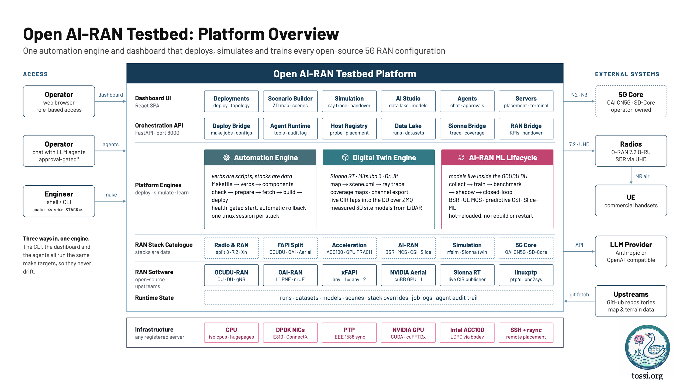
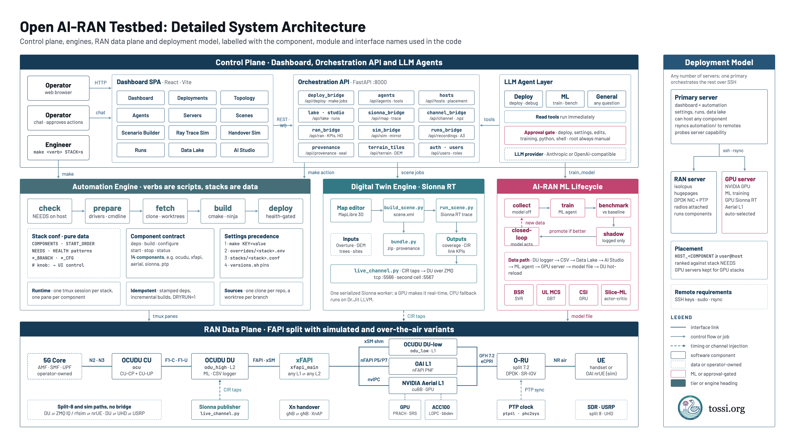
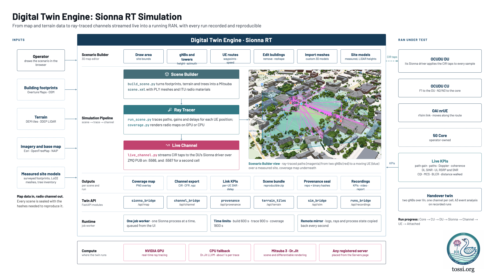
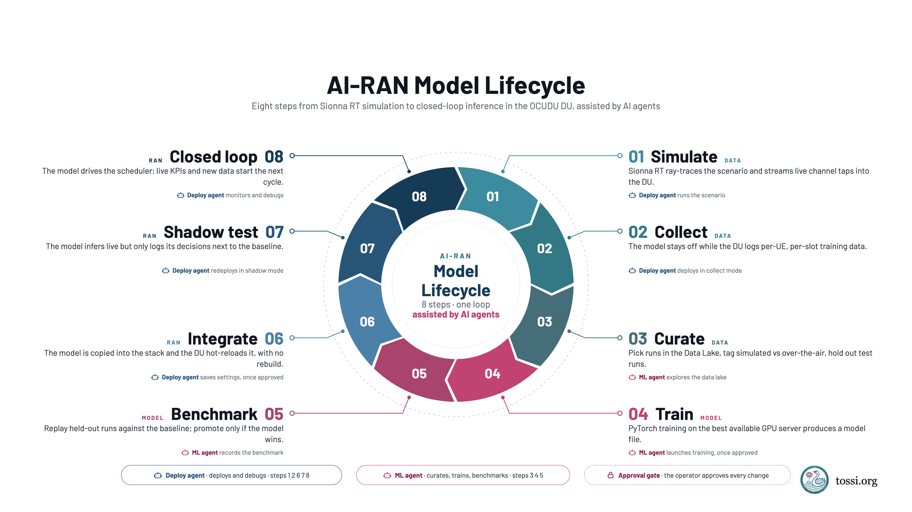

# Open AI-RAN Testbed by TOSSI

One platform to deploy, simulate and train every TOSSI RAN setup, from the command line or a web dashboard.

- **Deploy** OCUDU, OAI and Aerial RAN stacks on one server or split across several: split 8, split 7.2, FAPI splits, GPU and ACC100 acceleration, Xn handover.
- **Simulate** the radio channel with Sionna RT. Draw a scene on a 3D map, ray trace it, and run a real CU, DU and UE over the live ray-traced channel.
- **Train** the AI-RAN models (BSR periodicity, UL MCS, predictive CSI, Slice-ML) from datasets the DU collects, then bring them into service through shadow mode.
- **Operate** with LLM agents that can deploy, debug and train for you, behind an approval for anything that changes the system.



Verbs are scripts, stacks are data: adding a new deployment is a conf file, not a new script.

```bash
make list                       # what can be deployed
make check   STACK=<s>          # can this host run it?  (FIX=1 to remediate)
make all     STACK=<s>          # install -> build -> deploy
make status | logs C=ocudu F=1 | stop | clean
make dashboard                  # the web UI: http://<host-ip>:8000
```

`DRYRUN=1` prints every command and runs none. `VERBOSE=1` echoes as it goes. `WORKSPACE=` moves the source tree (default `~/tossi-ran`).

---

## Architecture

The dashboard is a web front end over the same `make` targets you would run by hand.
Anything you do with a button can also be done from the shell, and the two share their settings.



| Layer | Location | Role |
|---|---|---|
| Automation engine | `automation/` | `verbs/` (check, build, deploy, run, train), `components/` (how to build and run one thing), `stacks/*.conf` (what to deploy) |
| Entry point | `Makefile` | `make list`, `make check`, `make all`, `make stop`, `make train`, `make dashboard` |
| Backend | `dashboard/backend/app/` | FastAPI. Runs `make` jobs, drives Sionna, mirrors remote runs, serves the built UI |
| Frontend | `dashboard/frontend/` | React + TypeScript + Vite |
| Map and ray tracing | `dashboard/sionna-map/` | MapLibre scene editor plus the Sionna RT scene builder, tracer and coverage solver |
| Runtime state | `var/` | Logs, run records, datasets, settings, users. Never committed |

**The 5G core is the operator's.** A RAN stack never fetches, builds, checks, starts or stops it.
Bring up `core-oai-cn5g` or `core-sd-core` (or point at an external core) first.

## Layout

```
.
├── Makefile                 the entry point, for people and for the dashboard
├── automation/
│   ├── lib/                 includes.sh (execute, load_stack, wait_for, tmux, remote, run records)
│   │                        versions.sh (every repo URL, branch and pin)
│   ├── verbs/               check_system, cmdline, install_deps, install_drivers,
│   │                        setup_net_ifs, fetch, build, deploy, run, train
│   ├── components/          how to build and run one thing (deps build configure start stop status)
│   ├── stacks/              what to deploy: one sourced-bash conf per stack, no logic
│   ├── configs/             ML overlays (ai-ran/), PTP profiles, kernel cmdline profiles
│   ├── docs/                ML integration rulebook
│   ├── patches/             fixes applied to upstream trees
│   └── scripts/             helpers components run (dataset collection, USRP probe)
├── dashboard/               web UI (React + FastAPI) and the Sionna map module
└── var/                     runtime state, never committed
    ├── overrides/<stack>.env    per-stack settings, shared by the CLI and the dashboard
    ├── run/<stack>/             pids, tmux panes and per-component logs
    ├── runs/<stack>/<id>/       one record per deployment: metadata, logs, data
    ├── datasets/<stack>/        results and collected ML datasets
    └── dashboard/               users, servers, jobs, agent history, LLM settings
```

## Dashboard

```bash
make dashboard               # build the UI and serve it on 0.0.0.0:8000
cd dashboard && ./run.sh dev # hot reload on :5173
```

| Page | Use it to |
|---|---|
| **Dashboard** | See agent activity, the latest scene, machine health, models and data, recent runs |
| **Deployments** | Check, build, deploy, stop and train stacks; edit their configs; read job and component logs |
| **Topology** | See each running stack drawn as a network (core, CU, DU, L1, radio, UE) with interface labels and live KPIs |
| **Agents** | Chat with the Deploy, ML and General agents; approve their actions; configure the LLM |
| **Servers** | Register remote servers, check their capabilities, open a terminal on them |
| **Scenes** | Library of Sionna scenes |
| **Scenario Builder** | Draw an area, place gNBs, towers, UEs and routes, build the 3D scene, ray trace, compute coverage |
| **Simulation** | Ray Trace: CU + DU + UE over a live Sionna channel. Handover: two cells over Xn with a moving UE |
| **Runs** | History of stack deployments and simulation recordings |
| **Data Lake** | Every run's logs and CSV datasets, by stack; pick datasets for training |
| **AI Studio** | Datasets, models and benchmarks, with the ML agent beside them |
| **Admin** | Users, roles and passwords |

Sign in with a user account. There are three roles:

| Role | Can do |
|---|---|
| `admin` | Everything, including adding people, changing roles and resetting passwords |
| `operator` | Everything except managing people |
| `viewer` | Sees every page, changes nothing |

The dashboard listens on every interface (`HOST=127.0.0.1 make dashboard` keeps it local).
The backend starts RAN processes with `sudo`, so on the network it refuses the well-known default password.
Unless you set `TOSSI_PASSWORD`, a random one is generated once into `var/dashboard/password` (mode 600) and printed at start-up; it belongs to the first `admin` account.

## Stacks

A green dot in Deployments marks a running stack. Each one links its tossi.org tutorial.

| Group | Stack | What it deploys |
|---|---|---|
| 5G Core | `core-oai-cn5g` | OAI CN5G (docker compose), for any RAN stack or your own gNB |
| | `core-sd-core` | Aether SD-Core on RKE2 Kubernetes |
| AI-RAN | [`ai-ran-bsr`](https://tossi.org/docs/ran-integration/ai-ran/bsr-periodicity/) | ML BSR periodicity (branch `dev`); `SIM_UE=1` adds a ZMQ UE and a dataset copy |
| | [`ai-ran-mcs`](https://tossi.org/docs/ran-integration/ai-ran/ml-mcs/) | ML UL MCS (`ml_mcs_model`) |
| | [`ai-ran-csi`](https://tossi.org/docs/ran-integration/ai-ran/predictive-csi-link-adaptation/) | Predictive CSI (`ml_csi`) |
| | [`ai-ran-slice`](https://tossi.org/docs/ran-integration/ai-ran/slice-ml/) | Slice-ML with eMBB + URLLC slices (`slice_ml`) |
| Simulation | [`sionna-rt-ocudu`](https://tossi.org/docs/ran-integration/digital-twins/sionna-rt-ocudu-ran/) | Sionna RT ray-traced channel live into an OCUDU CU/DU and an OAI UE over rfsimulator |
| | [`rfsim-multi-ue`](https://tossi.org/docs/ran-integration/rfsim-testbed/) | OCUDU gNB + N OAI nrUEs over rfsim, iperf3 sweep and per-UE report |
| | [`multi-ue-sim`](https://tossi.org/docs/ran-integration/multi-ue-sim/) | Multi-UE simulation against a running OCUDU gNB |
| FAPI split | [`ocudu-l1-xfapi-ocudu-l2`](https://tossi.org/docs/ran-integration/fapi-split/xfapi-bridge/) | OCUDU L1, xFAPI and OCUDU L2 over xSM shared memory |
| | [`oai-l1-xfapi-ocudu-l2`](https://tossi.org/docs/ran-integration/fapi-split/oai-xfapi-ocudu/) | OAI L1 (nFAPI PNF), xFAPI and OCUDU L2 |
| | [`aerial-l1-xfapi-ocudu-l2`](https://tossi.org/docs/ran-integration/fapi-split/aerial-xfapi-ocudu/) | NVIDIA Aerial L1, xFAPI (nvIPC to xSM) and OCUDU L2 |
| Acceleration | [`ocudu-gpu-inline`](https://tossi.org/docs/ran-integration/hardware-acceleration/inline-gpu-prach-srs/) | 7.2 with inline GPU fronthaul: PRACH and SRS straight off the NIC |
| | [`ocudu-prach-gpu`](https://tossi.org/docs/ran-integration/hardware-acceleration/prach-gpu/) | 7.2 with GPU PRACH detection |
| | [`ocudu-hwacc-acc100`](https://tossi.org/docs/ran-integration/hardware-acceleration/acc100-ldpc/) | 7.2 with Intel ACC100 LDPC offload |
| Radio & RAN | `ocudu-split8-zmq` | OCUDU CU + split-8 DU over ZMQ with OAI nrUE, no radio |
| | `ocudu-split8-usrp` | OCUDU split 8 over a USRP (X4xx, N3xx, B2xx) via UHD |
| | `ocudu-split72-liteon` | OCUDU split 7.2 against a LiteOn O-RU over DPDK fronthaul |
| | [`ocudu-xnap-handover`](https://tossi.org/docs/ran-integration/xn-handover/) | Inter-gNB Xn handover: two gNBs, one per server, LiteOn 7.2 RUs |

The `ai-ran-*` stacks bring up CU and DU with that feature's dataset logger switched on (`configs/ai-ran/*_collect.yml`) and stop there, ready for a UE.
Shared wiring lives in `stacks/ai-ran-common.sh`, including the `RADIO` knob (`zmq` or a LiteOn O-RU over 7.2).

## The contract

Every component implements `deps build configure start stop status`.
Every stack declares `COMPONENTS`, `START_ORDER`, `NEEDS`, and the per-component variables those scripts read.
That is the whole extension mechanism.

```bash
# stacks/ocudu-split8-zmq.conf
COMPONENTS="ocudu-cu ocudu oai-nrue core5g"
START_ORDER="core5g ocudu-cu ocudu oai-nrue"
NEEDS="zmq python3"
OCUDU_BRANCH=dev
OCUDU_CFG=du_liteon_zmq.yaml
CU_CFG=cu.yml
HEALTH="ocudu-cu:(====.*started) ocudu:(====.*started) ..."
```

`HEALTH` is space-separated, so patterns must not contain a literal space: write `(gNB.started)`.
Header lines the dashboard reads: `# desc:` (description), the first `https://` link (tutorial) and `# knob:` (a setting shown as a choice in Configs).

## Several servers

`HOST_<COMPONENT>=user@host` runs that component on another server.
The name is upper-cased with `-` turned into `_`, so `HOST_OAI_GNB` is for `oai-gnb`.
Set it in **Deployments → Configs → Servers**, or in `var/overrides/<stack>.env`.

```bash
echo 'HOST_OAI_GNB=seven@server5' >> var/overrides/oai-l1-xfapi-ocudu-l2.env
make all STACK=oai-l1-xfapi-ocudu-l2
```

This server stays in charge.
Before each verb it copies `automation/` and the stack's settings to `~/tossi-automation` on the remote with rsync (`REMOTE_REPO` changes that), then runs the component there over SSH.
Health checks and logs come back the same way.

The other server needs key-based SSH from here, passwordless `sudo`, `rsync`, and its own configs at the paths the stack names.
The dashboard ranks servers against each stack's `NEEDS` (GPU, DPDK, NIC, hugepages, PTP, bbdev) from a capability probe; **Ping & test** on the Servers page refreshes it.

## Digital twin: Sionna RT



1. **Scenario Builder**: draw an area on the 3D map, place up to two gNBs, towers, UEs and a UE route, then build the scene from Overture buildings (or a measured site model).
2. **Ray trace** every cell and compute a **coverage** map. Build, trace and coverage run as jobs, one Sionna process at a time.
3. **Simulation → Ray Trace**: pick a server where `sionna-rt-ocudu` has come up before and select **Run on <server>**.
   The dashboard copies the scene there, writes the publisher's arguments, and runs `make deploy STACK=sionna-rt-ocudu`.
   A remote run is mirrored back over SSH once a second, so the live map, KPIs and logs work as if it ran locally.
4. **Simulation → Handover**: two cells over Xn, each with its own Sionna channel, and a UE that walks between them.

A measured site model is included for the Virginia Tech campus: surveyed footprints with LiDAR heights, roof colours from aerial imagery and the campus tree inventory, ray traced as foliage.
Without a GPU, Sionna traces on the CPU through Dr.Jit LLVM, at roughly one second per trace.

Point the dashboard at the Python that has Sionna RT with `TOSSI_SIONNA_PYTHON` (default `~/sionna-rt-env/bin/python3`).

## ML: collect, train, run



The `ai-ran-*` stacks have an `ML_MODE` setting:

| Mode | Behaviour |
|---|---|
| `collect` | Logs a dataset. The model is not used. Default |
| `shadow` | Runs the model and logs its decision next to the baseline, without acting on it |
| `closed-loop` | Applies the model's decision |

Dataset logging stays on in every mode.
`make train STACK=<s>` trains `ML_MODEL` on the collected datasets, here or on `TRAIN_HOST=user@host`; the dashboard's **Train** picks the best GPU server itself.
The DU reloads the model file whenever it changes, so a retrain needs no rebuild and no restart.
The lifecycle is always **collect → train → shadow → closed-loop**; the rules are in [`automation/docs/ml-integration-rulebook.md`](automation/docs/ml-integration-rulebook.md).

In the dashboard, pick datasets in the **Data Lake** or **AI Studio** and the ML agent trains on exactly those files, records a benchmark against the baseline, and proposes each promotion step for approval.

Known upstream limits: ML MCS has no shadow mode, and the CSI GRU trainer imports `train_export_csi_wiener.py`, which `ml_csi` never committed.

## LLM agents

| Agent | Scope |
|---|---|
| **Deploy** | Builds, deploys and debugs stacks; can run shell commands on any registered server when the normal path fails |
| **ML** | Datasets, training, models and the OCUDU ML code |
| **General** | Anything about the testbed and 5G, without shell access |

They use the same functions as the Deployments API.
Anything that changes the system waits for **Approve**; **Auto-approve** skips that, except for commands run as root, which always need a person.
Configure the provider (Anthropic or any OpenAI-compatible endpoint) under **Agents → LLM settings**.

## Kernel cmdline

Stacks that need boot-time tuning declare `KERNEL_PROFILE`.
`make cmdline STACK=<s>` diffs `/proc/cmdline` against the profile and exits non-zero if anything is off; `prepare` runs that check and reports instead of failing the build.

```bash
make cmdline STACK=ocudu-split72-liteon            # report
make cmdline STACK=ocudu-split72-liteon APPLY=1    # asks first, then writes
```

Values come from the machine: `isolcpus` from `nproc` (the last `HK_COUNT`, default 4, cores are housekeeping) and 1G hugepages from RAM (a quarter, never leaving the OS under 16G).
Override with `ISOL_CPUS=`, `HK_CPUS=`, `HUGEPAGES_1G=`. A pool already larger than the derivation is kept.

`APPLY=1` shows every parameter it will add or change and the file it will write, then asks.
It writes `/etc/default/grub.d/cmdline.cfg`, so `GRUB_CMDLINE_LINUX_DEFAULT` is untouched and removing that file plus `update-grub` undoes it. It never reboots.

| Profile | For |
|---|---|
| `ran-72` | COTS x86 7.2 split: vfio/IOMMU, 1G + 2M hugepages, isolation, latency |
| `aerial-x86` | Aerial on x86, from `install_aerial_kernel.sh` |
| `aerial-gh200` | Aerial on GH200: 512M hugepages, `irqaffinity=0` |

## PTP

Any stack with an external radio starts `ptp4l` and `phc2sys` before the RU, because a 7.2 RU never locks otherwise.
They run as panes of the stack's tmux session, mirrored into `var/run/<stack>/ptp.log` for the health gate.
A `ptp4l` already serving the port, including a hand-built one, is reused.

| `PTP_PROFILE` | For | Commands |
|---|---|---|
| `falcon` (default) | COTS server + Fibrolan Falcon-RX GM, E810 | `ptp4l -i $IF -m -H -2 -s -f <cfg>` · `phc2sys -w -m -s $IF -R 8 -f <cfg>` |
| `aerial` | GH200 / DGX Spark + ConnectX-7 | `ptp4l -f <cfg> -m` · `phc2sys -s $IF -c CLOCK_REALTIME -n 24 -O 0 -R 256 -u 256` |

Set the interface with `IF=` (`make all STACK=<s> IF=ens6f0`) or `PTP_IF`.
If the configured port is not on the server running the stack, the port of a running `ptp4l` is used instead.
`PTP_CFG=/path/to/your.cfg` replaces the shipped config.

## Gating

`check` runs first in `prepare`, `install`, `build` and `deploy`, so a host that cannot run a stack is told in seconds, before anything is cloned.
It checks only what `NEEDS` lists, and for Aerial stacks it delegates to NVIDIA's own `cuBB_system_checks.py`.

## Requirements

- Linux with `bash`, `make`, `tmux` and `sudo`; a lowlatency or PREEMPT_RT kernel for real-time stacks (tested on Ubuntu 22.04)
- Node 18+ and npm, Python 3.10+ for the dashboard
- A Sionna RT environment for the digital twin (optional; everything else runs without it)
- For remote servers: key-based SSH, passwordless `sudo`, `rsync`
